<!-- Generated by GitHub Profile Agent Console. Edit profile.config.json, then run npm run generate. -->

  <picture>
    <source media="(max-width: 760px) and (prefers-color-scheme: dark)" srcset="./assets/hero/agent-console-3bd6e9d7-mobile-dark.svg">
    <source media="(max-width: 760px)" srcset="./assets/hero/agent-console-3bd6e9d7-mobile-light.svg">
    <source media="(prefers-color-scheme: dark)" srcset="./assets/hero/agent-console-3bd6e9d7-dark.svg">
    <source media="(prefers-color-scheme: light)" srcset="./assets/hero/agent-console-3bd6e9d7-light.svg">
    
  </picture>

 

## About Me

I build full-stack web applications with a focus on practical interfaces, backend services, and reliable data integration.

I am also exploring conversational AI and data processing systems that make complex information easier to understand and everyday tasks faster to complete.

## Current Focus

| Area | What I am exploring |
| --- | --- |
| **Full-stack Products** | Building practical web applications from frontend interface to backend services. |
| **Frontend Engineering** | Responsive interfaces, interaction design, and clear user experiences. |
| **Backend APIs** | Server-side features, database integration, and application data flows. |

## Featured Work

| Project | Focus | Why it matters |
| --- | --- | --- |
| [**Tabungan Mimpiku**](https://github.com/imalzcool16-prog/Tabungan-Mimpiku) | Full-stack savings application | A web-based savings application with a glassmorphism interface and interactive frontend built with HTML, CSS, and JavaScript, supported by Node.js, Express.js, MongoDB, and Mongoose backend features. [Live](https://tabungan-mimpiku-production.up.railway.app) |

## Research Direction

I am focused on building complete web applications, from responsive user interfaces to backend APIs and database integrations that support useful real-world workflows.

## Tech Stack

`HTML5` · `CSS3` · `JavaScript` · `React.js` · `Node.js` · `Express.js` · `PHP` · `REST APIs` · `MongoDB` · `Mongoose` · `MySQL` · `Git` · `GitHub` · `Vercel` · `Railway` · `MongoDB Atlas` · `Responsive Web Design` · `Basic Networking`

## Recent Activity

<!-- AUTO:ACTIVITY:START -->
_Recent public activity will appear here after the workflow runs._
<!-- AUTO:ACTIVITY:END -->

---

  Building practical web applications and learning by shipping.

